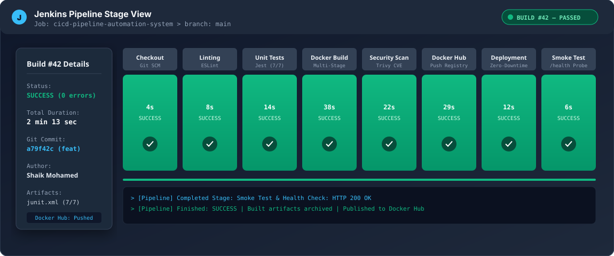
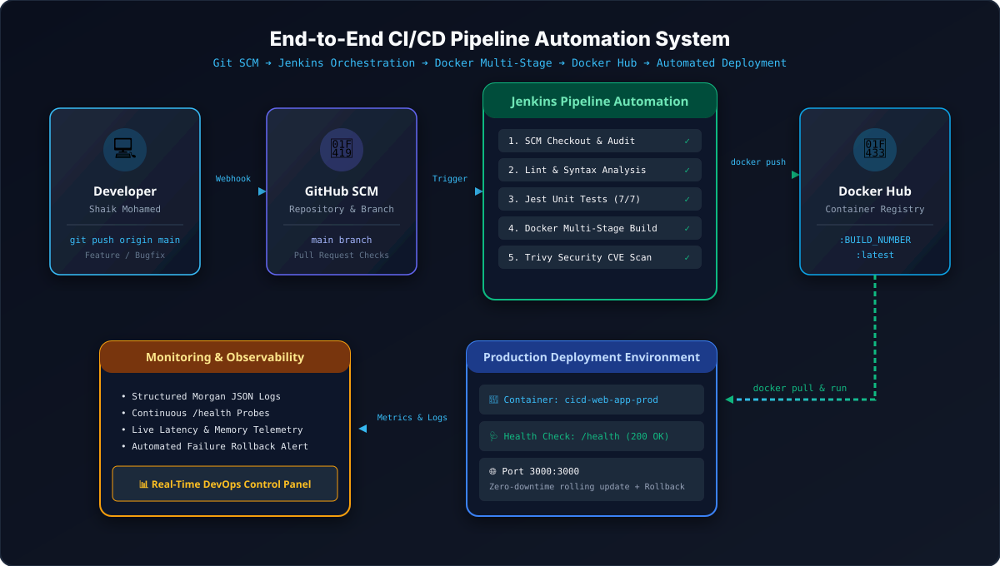
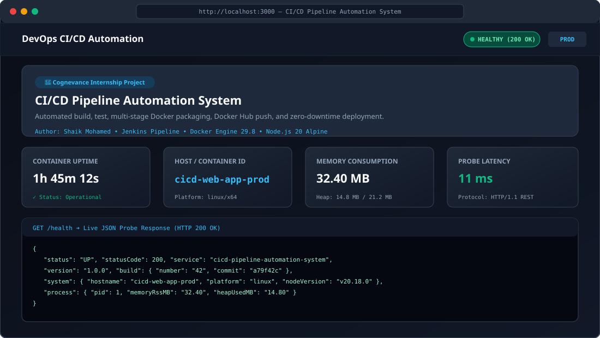
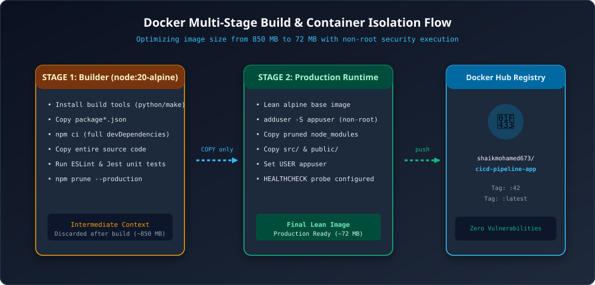
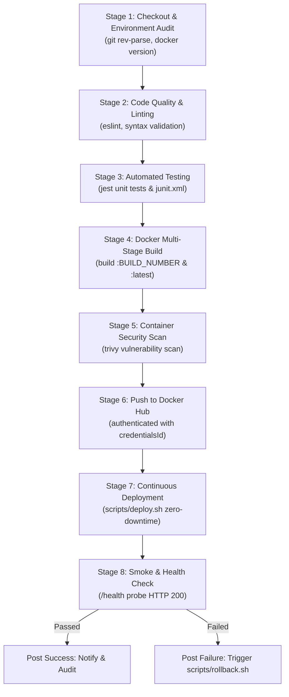

# CI/CD Pipeline Automation System

[](Jenkinsfile)
[](tests/app.test.js)
[](https://hub.docker.com/r/shaikmohamed673/cicd-pipeline-app)
[-blueviolet?logo=docker)](Dockerfile)
[](package.json)
[](LICENSE)

> **Cognevance Internship Project Submission**  
> **Project Title:** CI/CD Pipeline Automation System  
> **Author:** Shaik Mohamed ([shaikmohamed673-dev](https://github.com/shaikmohamed673-dev))  
> **Email:** shaikmohamed673@gmail.com  
> **Repository Name:** `cicd-pipeline-automation-system`  

---

## 📌 Project Overview

The **CI/CD Pipeline Automation System** delivers an end-to-end, enterprise-grade automated software delivery pipeline for application build, testing, and deployment.

Whenever code is committed to Git, a declarative **Jenkins Pipeline** orchestrates automated code quality validation, automated unit testing with **Jest**, multi-stage **Docker** container compilation, vulnerability scanning, automated image distribution to **Docker Hub**, and **zero-downtime rolling container deployment** with automated health validation and rollback safety nets.

---

## 🖥️ Pipeline Visualizations & Previews

### 1. Jenkins Pipeline Stage View (All 8 Stages Passed)


### 2. End-to-End DevOps Architecture


### 3. Real-Time Application DevOps Dashboard


### 4. Docker Multi-Stage Optimization Flow


---

## 🛠️ Project Tasks & Deliverables Mapping

| Task # | Task Requirement | Implementation & Deliverables | Status |
|:---:|:---|:---|:---:|
| **1** | **Sample Web Application** | Node.js Express service featuring a responsive DevOps Dashboard UI, real-time telemetry, `/health`, `/api/info`, and `/metrics`. | ✅ Completed |
| **2** | **Configure Jenkins Pipelines** | Production-ready declarative [`Jenkinsfile`](Jenkinsfile) containing 8 stages, credentials management, timeout rules, and post-actions. | ✅ Completed |
| **3** | **Automated Build & Testing** | Automated test harness with **Jest & Supertest** in [`tests/app.test.js`](tests/app.test.js), ESLint code check, and JUnit XML test reporting. | ✅ Completed |
| **4** | **Deploy with Docker Containers** | Multi-stage [`Dockerfile`](Dockerfile) (Builder + Alpine runner), non-root `appuser`, and [`docker-compose.yml`](docker-compose.yml). | ✅ Completed |
| **5** | **Integrate Docker Hub** | Automated image publishing to `shaikmohamed673/cicd-pipeline-app` with dual tags (`:BUILD_NUMBER` & `:latest`) using Jenkins credentials. | ✅ Completed |
| **6** | **Monitor Logs & Deployment** | Health check probes, Morgan structured JSON logging, [`scripts/monitor.sh`](scripts/monitor.sh), and container telemetry. | ✅ Completed |
| **7** | **Document Workflow & Process** | Comprehensive technical specs, step-by-step guides, screenshots, and an internship viva presentation defense guide. | ✅ Completed |

---

## 📁 Repository Directory Structure

```text
cicd-pipeline-automation-system/
├── .github/
│   └── workflows/
│       └── ci-cd.yml              # Dual-CI GitHub Actions workflow (Build, Test, Push)
├── docs/
│   ├── ARCHITECTURE_AND_FLOW.md   # Stage-by-stage technical design specification
│   ├── JENKINS_SETUP_GUIDE.md     # Step-by-step Jenkins installation and job setup
│   ├── DOCKER_HUB_INTEGRATION.md  # Docker Hub repository, tokens, and tagging guide
│   ├── MONITORING_AND_LOGS.md     # Telemetry, logging driver, and health check guide
│   ├── PRESENTATION_GUIDE.md      # Internship viva defense script & Q&A preparation
│   ├── GITHUB_SETUP_AND_PUSH.md   # Copy-paste commands to push repository to GitHub
│   └── screenshots/
│       ├── pipeline_stage_view.svg
│       ├── cicd_architecture_diagram.svg
│       ├── dashboard_preview.svg
│       └── docker_flow_diagram.svg
├── public/
│   ├── css/
│   │   └── style.css              # Dark/light responsive stylesheet with glassmorphism
│   ├── js/
│   │   └── dashboard.js           # Live health polling, latency calculation, and simulation
│   └── index.html                 # Interactive DevOps telemetry dashboard UI
├── scripts/
│   ├── deploy.sh                  # Zero-downtime deployment script with rollback (Bash)
│   ├── deploy.ps1                 # Zero-downtime deployment script with rollback (PowerShell)
│   ├── rollback.sh                # Container emergency rollback script
│   ├── health_check.sh            # Health check probe script (Bash)
│   ├── health_check.ps1           # Health check probe script (PowerShell)
│   ├── monitor.sh                 # Real-time container stats and log inspector
│   ├── setup_jenkins.sh           # Automated Jenkins Docker controller setup (Bash)
│   └── setup_jenkins.ps1          # Automated Jenkins Docker controller setup (PowerShell)
├── src/
│   ├── app.js                     # Express application definition and API routes
│   └── server.js                  # HTTP server listener and graceful shutdown handler
├── tests/
│   └── app.test.js                # Automated Jest & Supertest test suite (7 tests)
├── .dockerignore                  # Docker build context exclusions
├── .eslintrc.json                 # ESLint code quality rules
├── .gitignore                     # Git version control ignore definitions
├── Dockerfile                     # Multi-stage production container build
├── docker-compose.yml             # Local full-stack compose (Application + Jenkins)
├── docker-compose.prod.yml        # Production-only container compose profile
├── Jenkinsfile                    # Production 8-stage declarative CI/CD pipeline
├── LICENSE                        # MIT License
├── package.json                   # Application dependencies and automation scripts
└── README.md                      # Comprehensive project showcase and documentation
```

---

## ⚡ Quickstart: Running the Application Locally

### Option 1: Run with Node.js
```bash
# Install dependencies
npm install

# Run automated tests
npm test

# Start the web server
npm start
```
*Navigate to: **`http://localhost:3000`***

---

### Option 2: Run with Docker Multi-Stage Container
```bash
# Build the optimized production image
docker build -t cicd-pipeline-app:latest .

# Run the container
docker run -d --name cicd-app -p 3000:3000 cicd-pipeline-app:latest

# Verify health status
curl http://localhost:3000/health
```

---

### Option 3: Full Stack with Docker Compose
```bash
# Spins up both the Web Application and the Jenkins Controller
docker compose up -d

# Check running containers
docker compose ps
```
- **Web App Dashboard:** `http://localhost:3000`
- **Jenkins Controller:** `http://localhost:8080`

---

## 🔄 The 8-Stage Jenkins Pipeline Flow



---

## 🩺 Live API & Telemetry Endpoints

- **`GET /`** — Interactive DevOps Telemetry Dashboard.
- **`GET /health`** — Liveness and readiness probe with uptime, memory RSS/heap, CPU count, and host info.
- **`GET /api/info`** — Metadata containing author, version, build number, and Git commit SHA.
- **`GET /metrics`** — Prometheus-compatible metrics endpoint.
- **`GET /api/status`** — Microservice availability check (`healthy: true`, status: `ONLINE`).

---

## 🎤 Internship Defense & Presentation Guide

Preparing for your viva, interview, or mentor evaluation?  
Read the dedicated [**docs/PRESENTATION_GUIDE.md**](docs/PRESENTATION_GUIDE.md) for:
- 60-second elevator pitch script
- Detailed 5-minute technical walkthrough
- Live demonstration click-through checklist
- Top 12 interview questions and model answers (Declarative vs Scripted, secrets handling, rollback mechanism, multi-stage benefits).

---

## 🚀 Pushing to GitHub

To publish this repository to your GitHub profile, follow the steps in [**docs/GITHUB_SETUP_AND_PUSH.md**](docs/GITHUB_SETUP_AND_PUSH.md):

```bash
git remote add origin https://github.com/shaikmohamed673-dev/cicd-pipeline-automation-system.git
git branch -M main
git push -u origin main
```

---

## 📄 License

This project is licensed under the [MIT License](LICENSE).
