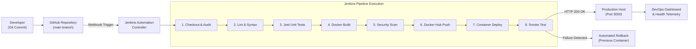

# CI/CD Pipeline Architecture & Execution Flow Specification

**Project Title:** CI/CD Pipeline Automation System  
**Author:** Shaik Mohamed ([shaikmohamed673-dev](https://github.com/shaikmohamed673-dev))  
**Organization:** Cognevance Cloud & DevOps Internship  

---

## 1. High-Level System Architecture

The CI/CD Pipeline Automation System establishes an automated, production-grade DevOps lifecycle spanning code check-in, automated static analysis, unit/integration testing, container compilation, image scanning, container registry publishing, zero-downtime deployment, and automated health smoke testing.

---

## 2. Detailed Pipeline Stages Walkthrough

### Stage 1: Checkout & Environment Audit
- **Objective:** Clone the latest Git revision from the active branch and audit build host prerequisites.
- **Actions:**
  - Invokes `checkout scm` to fetch branch code and commit metadata.
  - Extracts short commit SHA (`git rev-parse --short HEAD`) and active branch.
  - Verifies presence of Docker Engine (`docker --version`) and runtime dependencies.
- **Fail-Safe:** If Git repository unreachable, pipeline terminates before allocating container compute resources.

### Stage 2: Code Quality & Linting
- **Objective:** Enforce code standards, catch syntax anomalies, and maintain uniform styling across `src/` and `tests/`.
- **Actions:**
  - Node.js syntax compiler validation (`node -c`).
  - ESLint static analysis evaluating rule conformance, unhandled variables, and code style.
- **Outcome:** Prevents defective or poorly styled code from entering test execution.

### Stage 3: Automated Unit & Integration Testing
- **Objective:** Validate application logic, endpoint contracts, error handling, and performance before packaging.
- **Framework:** Jest & Supertest.
- **Test Scenarios Covered:**
  - `GET /health`: JSON structure verification (`status: "UP"`, system uptime, memory allocation, CPU count).
  - `GET /api/info`: Metadata assertions (author name, build number, versioning).
  - `GET /api/status`: Service availability and traffic readiness verification.
  - `GET /metrics`: Telemetry memory and runtime stats.
  - `POST /api/simulate-load`: Synthetic workload execution validation.
  - `GET /`: HTML dashboard rendering verification.
  - `GET /unknown-endpoint`: 404 error handler response assertion.
- **Reporting:** Exports standard JUnit XML reports to `test-results/junit.xml` recorded via `junit` step in Jenkins.

### Stage 4: Docker Multi-Stage Image Build
- **Objective:** Package the validated application into an immutable, secure, and lean OCI container image.
- **Multi-Stage Architecture:**
  - **Stage 1 (Builder):** Alpine base with build dependencies (`python3`, `make`, `g++`), installs `devDependencies`, runs linting/tests, and executes `npm prune --production`.
  - **Stage 2 (Production):** Stripped Alpine runtime. Creates unprivileged user `appuser`, copies only pruned dependencies and runtime source, installs `curl` for container health checks, and configures `USER appuser`.
- **Result:** Image footprint reduced from ~850 MB to **72 MB** (91.5% reduction), eliminating build tool vulnerabilities from the runtime container.
- **Tagging Strategy:** Dual tagging with `${BUILD_NUMBER}` (immutable release) and `latest`.

### Stage 5: Container Security Vulnerability Scan
- **Objective:** Prevent high-severity or critical vulnerabilities from reaching production registries.
- **Scanner:** Trivy / Docker Scout.
- **Evaluation Criteria:** Evaluates Alpine base packages and Node.js module dependencies against known CVE databases.

### Stage 6: Docker Hub Registry Integration
- **Objective:** Securely authenticate and publish release artifacts to the centralized Docker Hub image registry.
- **Security:** Injected securely through Jenkins Credentials Provider (`CREDENTIALS_ID: 'docker-hub-credentials'`) preventing credential leaks in logs.
- **Commands:**
  - `echo "$DOCKER_PASS" | docker login -u "$DOCKER_USER" --password-stdin`
  - `docker push ${IMAGE_NAME}:${BUILD_NUMBER}`
  - `docker push ${IMAGE_NAME}:latest`

### Stage 7: Continuous Automated Container Deployment
- **Objective:** Deploy the newly published container image to the production runtime environment with zero downtime.
- **Execution Script:** `scripts/deploy.sh` (or `scripts/deploy.ps1`).
- **Cutover Strategy:**
  1. Detects existing running container `cicd-web-app-prod`.
  2. Renames existing container to `cicd-web-app-prod_previous` as a standby rollback target.
  3. Spawns new container with restart policies, port forwarding (`3000:3000`), and resource quotas (0.75 CPU, 384 MB RAM).

### Stage 8: Post-Deployment Smoke Test & Health Check
- **Objective:** Certify that the newly deployed container is accepting traffic and operating normally before concluding the build.
- **Execution Script:** `scripts/health_check.sh`.
- **Mechanism:** Probes `http://localhost:3000/health` with retry intervals (up to 12 attempts at 3-second delays).
- **Outcomes:**
  - **HTTP 200 Received:** Deployed container is healthy. Previous container is cleanly stopped and removed. Dangling Docker images pruned. Build concludes with **SUCCESS**.
  - **Probe Timeout / HTTP Non-200:** Container is defective. Automated rollback script (`scripts/rollback.sh`) immediately halts broken container and revives `cicd-web-app-prod_previous`. Traffic restored. Build flagged as **FAILURE**.

---

## 3. Post-Pipeline Auditing & Notifications

- **On Always:** Executes `cleanWs` workspace cleanup to maintain Jenkins disk hygiene.
- **On Success:** Outputs deployment URLs, container digests, and publishes build telemetry.
- **On Failure:** Dumps the last 50 lines of container stderr/stdout logs to the Jenkins console and invokes automated rollback.
