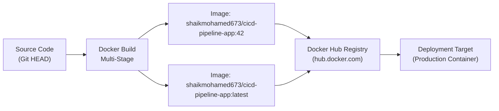

# Docker Hub Integration & Registry Publishing Guide

This document details the configuration, security baseline, and tagging taxonomy used for integrating **Docker Hub** into the automated CI/CD pipeline.

---

## 1. Registry Architecture & Tagging Strategy

Automated builds produce dual-tagged Docker images:
1. **Immutable Build Tag (`:BUILD_NUMBER`):** Provides complete traceability to the exact Jenkins build run and Git commit SHA (e.g. `shaikmohamed673/cicd-pipeline-app:42`).
2. **Rolling Latest Tag (`:latest`):** Represents the most recent verified production image for deployment nodes pulling updates automatically.



---

## 2. Docker Hub Account & Personal Access Token (PAT)

### Creating a Secured Access Token
For maximum security in CI/CD automation, use a **Personal Access Token (PAT)** with scoped read/write permissions rather than your primary Docker account password:

1. Log in to [Docker Hub](https://hub.docker.com/).
2. Click your avatar in the upper right ➔ **Account Settings**.
3. Select **Security** from the left navigation.
4. Click **New Access Token**.
5. Set Token Description: `jenkins-cicd-pipeline-token`.
6. Set Access Permissions: **Read, Write, Delete**.
7. Click **Generate** and securely copy the generated token string (`dckr_pat_...`).

---

## 3. Creating the Docker Hub Repository

1. In Docker Hub, navigate to **Repositories** ➔ **Create Repository**.
2. **Name:** `cicd-pipeline-app`
3. **Short Description:** `Production image for CI/CD Pipeline Automation System`
4. **Visibility:** `Public` (or `Private`)
5. Click **Create**.

Your full repository URI will be:  
**`https://hub.docker.com/r/shaikmohamed673/cicd-pipeline-app`**

---

## 4. Manual Verification & CLI Authentication

To verify authentication and push an image manually from your terminal:

```bash
# Authenticate with Docker Hub using your token
echo "<YOUR_DOCKER_HUB_PAT>" | docker login -u "shaikmohamed673" --password-stdin

# Build the container image locally
docker build -t shaikmohamed673/cicd-pipeline-app:1.0.0 -t shaikmohamed673/cicd-pipeline-app:latest .

# Push image tags to Docker Hub
docker push shaikmohamed673/cicd-pipeline-app:1.0.0
docker push shaikmohamed673/cicd-pipeline-app:latest
```

---

## 5. Jenkinsfile Integration Architecture

In the `Jenkinsfile`, credentials are never logged or stored in plain text. The Jenkins `withCredentials` block injects them into temporary subshell environment variables:

```groovy
stage('Push to Docker Hub') {
    steps {
        script {
            withCredentials([usernamePassword(
                credentialsId: 'docker-hub-credentials',
                usernameVariable: 'DOCKER_USER',
                passwordVariable: 'DOCKER_PASS'
            )]) {
                sh '''
                    echo "$DOCKER_PASS" | docker login -u "$DOCKER_USER" --password-stdin
                    docker push "${IMAGE_NAME}:${BUILD_NUMBER}"
                    docker push "${IMAGE_NAME}:latest"
                '''
            }
        }
    }
}
```

---

## 6. Inspecting Published Images

Once published, you can inspect image layers and digest metadata directly from the command line:

```bash
# Pull the latest published image
docker pull shaikmohamed673/cicd-pipeline-app:latest

# Inspect image details and metadata
docker inspect shaikmohamed673/cicd-pipeline-app:latest | grep -E "(maintainer|project|BUILD_NUMBER)"
```
