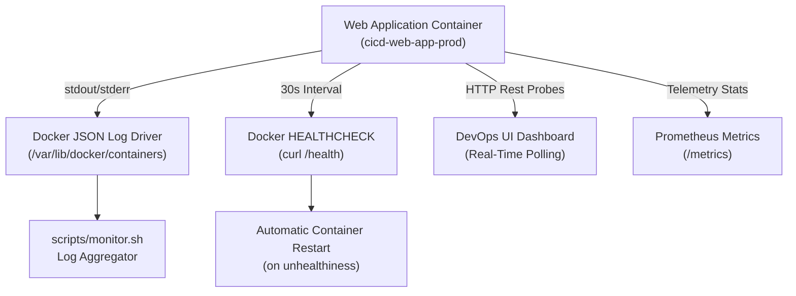
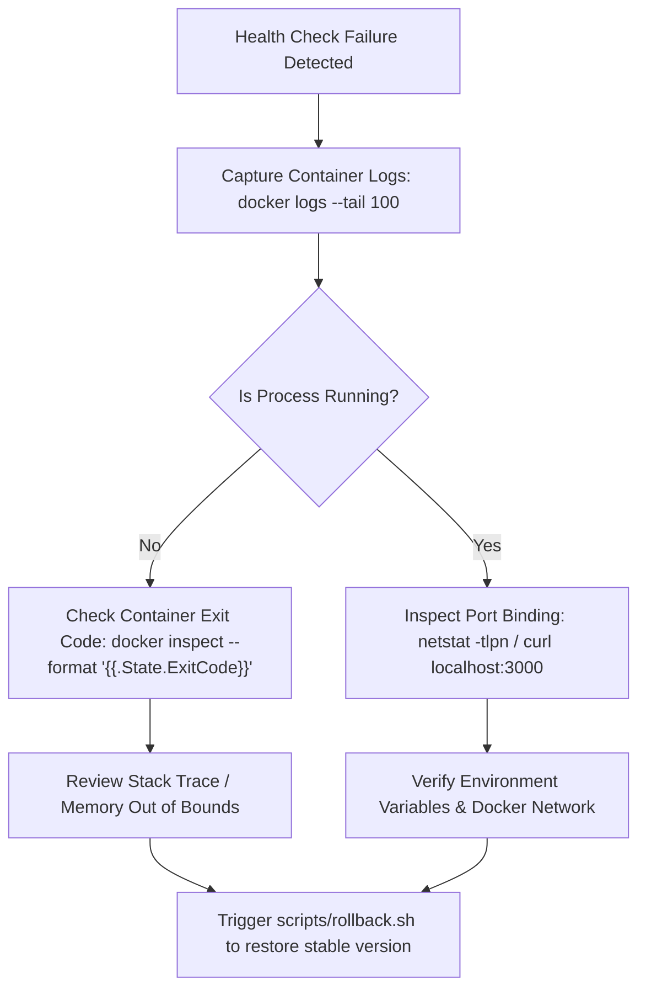

# Monitoring, Observability & Log Management Guide

**Project:** CI/CD Pipeline Automation System  
**Author:** Shaik Mohamed  

---

## 1. Observability Architecture Overview

The monitoring framework operates across three distinct operational layers:
1. **Application Layer:** Structured JSON access and operational logs emitted to `stdout`/`stderr` using Morgan.
2. **Container Runtime Layer:** Docker daemon healthcheck probes (`HEALTHCHECK`), CPU/Memory telemetry (`docker stats`), and restart supervisors.
3. **Network & Synthetic Layer:** Automated HTTP probes (`/health`, `/metrics`) executed by Jenkins, load balancers, and external status monitors.



---

## 2. Telemetry & Health API Endpoints

| Endpoint | Method | Format | Purpose | Response Code |
|:---|:---:|:---:|:---|:---:|
| `/health` | `GET` | JSON | Primary liveness and readiness probe for Docker and Jenkins. Contains uptime, host, PID, RSS & Heap memory. | `200 OK` |
| `/api/info` | `GET` | JSON | Deployment metadata including version, build number, git commit SHA, and environment. | `200 OK` |
| `/api/status` | `GET` | JSON | Lightweight microservice availability status check (`ONLINE`). | `200 OK` |
| `/metrics` | `GET` | JSON | Prometheus-compatible telemetry with process memory, CPU counts, active handles, and OS load. | `200 OK` |
| `/api/simulate-load` | `POST` | JSON | Synthetic workload testing endpoint for simulating CPU stress. | `200 OK` |

### Sample `/health` Response Payload:
```json
{
  "status": "UP",
  "statusCode": 200,
  "service": "cicd-pipeline-automation-system",
  "timestamp": "2026-10-20T10:45:00.123Z",
  "uptime": {
    "seconds": 3600,
    "formatted": "1h 0m 0s"
  },
  "version": "1.0.0",
  "build": {
    "number": "42",
    "commit": "a79f42c"
  },
  "system": {
    "hostname": "cicd-web-app-prod",
    "platform": "linux",
    "arch": "x64",
    "nodeVersion": "v20.18.0",
    "cpus": 4,
    "freeMemoryBytes": 4294967296,
    "totalMemoryBytes": 8589934592
  },
  "process": {
    "pid": 1,
    "memoryRssMB": "32.40",
    "heapUsedMB": "14.80",
    "heapTotalMB": "21.20"
  }
}
```

---

## 3. Real-Time Log Inspection Commands

### Viewing Application Logs:
```bash
# Stream live application logs in real-time
docker logs -f cicd-web-app-prod

# View last 50 log entries with timestamps
docker logs --tail 50 --timestamps cicd-web-app-prod
```

### Structured Log Format Example:
```text
2026-10-20T10:45:12.451Z | GET /health | 200 | 1.842 ms - 512
2026-10-20T10:45:16.120Z | GET /metrics | 200 | 0.941 ms - 280
2026-10-20T10:45:20.893Z | GET / | 200 | 4.120 ms - 14820
```

---

## 4. Container Resource & Health Monitoring

### Using the Automated Monitor Script:
```bash
chmod +x scripts/monitor.sh
./scripts/monitor.sh cicd-web-app-prod 3000
```

### Inspecting Docker Native Health Status:
```bash
# Query Docker health check state (healthy / unhealthy / starting)
docker inspect --format='{{json .State.Health.Status}}' cicd-web-app-prod

# Query last 3 health check probe logs
docker inspect --format='{{json .State.Health.Log}}' cicd-web-app-prod | jq .
```

### Live Resource Utilization:
```bash
docker stats --no-stream cicd-web-app-prod
```
Output:
```text
CONTAINER ID   NAME                 CPU %     MEM USAGE / LIMIT     MEM %     NET I/O
a1b2c3d4e5f6   cicd-web-app-prod    0.15%     32.4MiB / 384MiB      8.43%     1.2MB / 840KB
```

---

## 5. Troubleshooting & Triage Workflow


